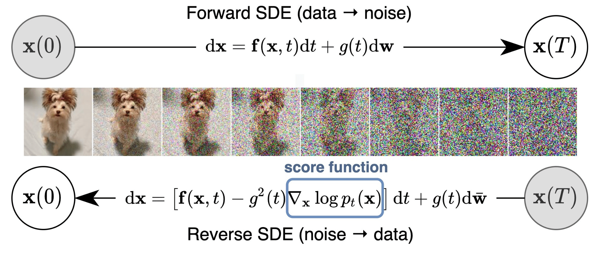

# 1. Introduction

Diffusion models are among the most successful generative models of recent years. They power modern image, audio and video generators, and they rest on an elegant piece of mathematics. The idea is easy to state. Take real data, for example images, and slowly destroy it by adding a little random noise at a time, until nothing but pure noise is left. This "noising" is easy. The surprising fact is that the process can be run *backwards*: starting from pure noise, we can remove noise step by step and end up with a brand new sample that looks like real data.

Running the process backwards requires one extra ingredient, called the *score*, which is the gradient of the logarithm of the probability density of the noisy data. The score is not known in closed form, so a neural network learns it from data. Once the network has learned the score, generating new data is just a matter of solving a differential equation backwards in time.

To make this precise we need a small amount of stochastic calculus: the mathematics of differential equations that contain random noise. This article builds it up from scratch. Section 2 starts from a simple random walk and develops Brownian motion, stochastic differential equations (SDEs), Ito's lemma, the Fokker-Planck equation, the forward and backward Kolmogorov equations, and finally the equation for reversing a diffusion process. Section 3 applies these tools to diffusion models: it introduces the forward noising SDE, its discretization (which connects to the well known DDPM model), the exact distribution of the noisy data, and the probability flow ODE. Section 4 explains how the score is learned through denoising score matching, and how new samples are generated.

**What you need.** Only ordinary calculus (derivatives, integrals, Taylor series, integration by parts) and a few basic facts about probability:

- $$\mathbb{E}[\cdot]$$ denotes the expectation (average) and $$\text{Var}[X]=\mathbb{E}[X^2]-\mathbb{E}[X]^2$$ the variance.
- $$\mathcal{N}(\mu,\sigma^2)$$ is a Gaussian (normal) distribution with mean $$\mu$$ and variance $$\sigma^2$$. A sum of *independent* Gaussian random variables is again Gaussian, and its mean and variance are the sums of the individual means and variances.
- For independent random variables $$X,Y$$, $$\mathbb{E}[XY]=\mathbb{E}[X]\,\mathbb{E}[Y]$$.

# 2. Stochastic Calculus

Consider a differential equation

\begin{equation}
dx = f(x)\, dt.
\end{equation}

Here $$f(x)$$ is completely deterministic: if we know $$x$$ now, we know exactly where it will be a moment later. We could also add a probabilistic term in the form

\begin{equation}
dx = f(x)\,dt + g(x)\,dw,
\end{equation}

where $$dw$$ is a small displacement that takes random values drawn from a probability distribution $$\mathcal{N}(0, \sigma^2 dt)$$. (Most texts, and the later parts of this article, set $$\sigma=1$$, so that $$dw\sim\mathcal{N}(0,dt)$$. We keep a general $$\sigma$$ for now because it makes the connection to the random walk clearer.) We will build up intuition behind this equation in the following subsections.

## 2.1 Discrete Random Walk

Consider a particle that starts at position $$x_0 = 0$$ at time $$t=0$$ and thereafter takes a step $$w_i$$ at time $$t = i$$ drawn from the probability distribution

\begin{equation}
p(w_i) = \begin{cases} 1/2 & w_i = d \cr 1/2 & w_i = -d \end{cases}
\end{equation}

The steps $$w_1, w_2, \ldots$$ are *independent*: the coin flip that decides one step knows nothing about the others. Each step has mean $$\mathbb{E}[w_i]=\frac{1}{2}d-\frac{1}{2}d=0$$ and $$\mathbb{E}[w_i^2]=d^2$$. The position of the particle after $$N$$ steps is

\begin{equation}
x(N) = \sum_{i=1}^N w_i.
\end{equation}

The mean position of the particle after $$N$$ steps is

\begin{equation}
\mathbb{E}[x(N)] = \sum_{i=1}^N \mathbb{E}[w_i] = 0.
\end{equation}

For the variance, note that for $$i\neq j$$ independence gives $$\mathbb{E}[w_iw_j]=\mathbb{E}[w_i]\mathbb{E}[w_j]=0$$, while for $$i=j$$ we have $$\mathbb{E}[w_i^2]=d^2$$. We can write both cases together as $$\mathbb{E}[w_iw_j]=d^2\delta_{ij}$$, where $$\delta_{ij}$$ is $$1$$ if $$i=j$$ and $$0$$ otherwise. The variance is

\begin{equation}
\text{Var}[x(N)] = \mathbb{E}[x(N)^2] - \mathbb{E}[x(N)]^2 = \sum_{i=1}^N\sum_{j=1}^N\mathbb{E}[w_iw_j] = d^2N.
\end{equation}

Therefore the standard deviation after $$N$$ steps is $$d\sqrt{N}$$. Notice that the typical distance travelled grows like $$\sqrt{N}$$, not like $$N$$: the random steps partly cancel each other.

Now let us calculate a few more quantities that will be of interest later. For $$N_1 > N_2$$,

\begin{equation}
\mathbb{E}[x(N_1) - x(N_2)] = \mathbb{E}[x(N_1)] - \mathbb{E}[x(N_2)] = 0.
\end{equation}

Then,

\begin{equation}
\begin{aligned}
\text{Var}[x(N_1)-x(N_2)] &= \mathbb{E}[(x(N_1)-x(N_2))^2] \cr
&=\mathbb{E}[x(N_1)^2]+\mathbb{E}[x(N_2)^2]-2\mathbb{E}[x(N_1)x(N_2)] \cr
&=d^2N_1 + d^2N_2 -2\mathbb{E}[x(N_1)x(N_2)].
\end{aligned}
\end{equation}

Now, using $$\mathbb{E}[w_iw_j]=d^2\delta_{ij}$$, only the terms with $$i=j$$ survive, and since $$N_2<N_1$$ there are $$N_2$$ of them:

\begin{equation}
\begin{aligned}
\mathbb{E}[x(N_1)x(N_2)]&=\mathbb{E}\left[\sum_{i=1}^{N_1}\sum_{j=1}^{N_2}w_iw_j\right] \cr
&=\mathbb{E}\left[\sum_{i=1}^{N_2}w_i^2\right] \cr
&=d^2N_2.
\end{aligned}
\end{equation}

Therefore,

\begin{equation}
\text{Var}[x(N_1)-x(N_2)] = d^2(N_1 - N_2).
\end{equation}

The variance of $$x(N_1)-x(N_2)$$ is proportional to the time interval between them. There is also a quicker way to see this: $$x(N_1)-x(N_2)=\sum_{i=N_2+1}^{N_1}w_i$$ is itself a sum of $$N_1-N_2$$ independent steps, so it behaves exactly like a fresh random walk of $$N_1-N_2$$ steps. Moreover it does not depend on the steps taken before time $$N_2$$. This property, called *independent increments*, is what will later make Brownian motion a Markov process.

## 2.2 Brownian Motion

The continuous version of the discrete random walk is called Brownian motion. We will take a small time interval $$\Delta t$$ and later take the limit $$\Delta t \rightarrow dt$$. The interval $$\Delta t$$ itself can be split into even smaller time intervals $$\delta t$$. Let

\begin{equation}
N = \frac{\Delta t}{\delta t}.
\end{equation}

The particle takes $$N$$ steps in the interval $$\Delta t$$, and at each step the probability of a displacement is

\begin{equation}
p(w_i) = \begin{cases} 1/2 & w_i = \delta d \cr 1/2 & w_i = -\delta d \end{cases}
\end{equation}

where $$\delta d$$ is a small step taken in a time $$\delta t$$. We want to find the probability distribution of the particle location after time $$\Delta t$$. From the previous subsection, the displacement after $$N$$ steps has mean $$0$$ and variance

\begin{equation}
N\delta d^2 = \frac{\Delta t}{\delta t}\delta d^2 .
\end{equation}

We now make the steps smaller and more frequent, $$N\rightarrow\infty$$. We have to be careful about how $$\delta d$$ shrinks. If $$\delta d$$ shrinks too slowly, the variance blows up; if it shrinks too fast, the particle does not move at all. The only interesting choice is to keep the ratio $$\delta d^2/\delta t$$ constant, which we call $$\sigma^2$$, i.e. $$\delta d=\sigma\sqrt{\delta t}$$. Then the variance is $$\sigma^2\Delta t$$ for every $$N$$. Finally, by the central limit theorem, a sum of many independent, identically distributed steps with finite variance becomes Gaussian. Therefore

\begin{equation}
p(x(\Delta t)) = \lim_{N \to \infty} p\left(\sum_{i=1}^N w_i \right) = \mathcal{N}(0, \sigma^2\Delta t).
\end{equation}

We are also interested in another probability distribution,

\begin{equation}
p(\Delta x) = p\big(x(t + \Delta t) - x(t)\big).
\end{equation}

Because of independent increments, the displacement between $$t$$ and $$t+\Delta t$$ is again a sum of $$N$$ fresh independent steps, so we can go through the same procedure as before and obtain

\begin{equation}
p(\Delta x) = \mathcal{N}(0, \sigma^2\Delta t).
\end{equation}

Now we take the limit $$\Delta t \rightarrow dt$$ and $$\Delta x \rightarrow dx$$:

\begin{equation}
p(dx) = \mathcal{N}(0,\sigma^2 dt). \label{eq:bm}
\end{equation}

To summarize, in an interval $$dt$$ the particle moves by a distance $$dx$$ drawn from a Gaussian distribution with mean $$0$$ and standard deviation $$\sigma \sqrt{dt}$$. Note that $$\sqrt{dt}$$ is much larger than $$dt$$ when $$dt$$ is small. This is the root of everything that is unusual about stochastic calculus.

## 2.3 Stochastic Differential Equations

Within the same interval $$dt$$, there could also be other sources of displacement, for example a drift term $$f(x, t)$$. If only such a drift term is present, then

\begin{equation}
dx = f(x,t)\, dt.
\end{equation}

If in addition we also have a Brownian motion term, then

\begin{equation}
dx = f(x,t)\, dt + g(x,t)\,dw, \label{eq:sde}
\end{equation}

where $$p(dw) = \mathcal{N}(0,\sigma^2 dt)$$. While we used $$dx$$ to denote the Brownian displacement in $$\eqref{eq:bm}$$, here $$dx$$ denotes the most general displacement, a part of which is contributed by the Brownian term $$dw$$. The drift $$f$$ pushes the particle in a definite direction, and $$g$$ sets how strongly it is shaken. It follows that, given the current position $$x$$ at time $$t$$,

\begin{equation}
dx \sim \mathcal{N}\left(f(x,t)\,dt,\; g^2(x,t)\,\sigma^2 dt \right).
\end{equation}

Since we know the probability distribution of $$dw$$, it is easy to see (these are the standard moments of a Gaussian) that

\begin{equation}
\begin{aligned}
\mathbb{E}[dw] &= 0 \cr
\mathbb{E}[dw^2] &= \sigma^2 dt \cr
\mathbb{E}[dw^3] &= 0 \cr
\mathbb{E}[dw^4] &= 3 \sigma^4 dt^2 \cr
\mathbb{E}[dw^5] &= 0 \cr
\mathbb{E}[dw^6] &= 15 \sigma^6 dt^3 \cr
&\;\;\vdots
\end{aligned} \label{eq:moments}
\end{equation}

In general $$\mathbb{E}[dw^{2n}]\propto dt^n$$ and the odd moments vanish. So, roughly, $$dw$$ is of size $$\sqrt{dt}$$, $$dw^2$$ is of size $$dt$$, and $$dw^3$$ is of size $$dt^{3/2}$$.

## 2.4 Ito's Lemma

Consider a function $$F(x(t), t)$$ where $$x(t)$$ evolves according to the SDE $$\eqref{eq:sde}$$. For a small displacement $$dx$$ and $$dt$$, a Taylor expansion tells us that $$F(x(t),t)$$ changes by

\begin{equation}
dF = \frac{\partial F}{\partial x}dx + \frac{\partial F}{\partial t}dt + \frac{1}{2}\frac{\partial^2 F}{\partial x^2}(dx)^2+\frac{1}{2}\frac{\partial^2 F}{\partial t^2}(dt)^2+\frac{\partial^2 F}{\partial x \partial t}dx\,dt + O\big((dx)^n (dt)^m\big), \quad n+m > 2.
\end{equation}

Now,

\begin{equation}
\begin{aligned}
dx &= f(x,t)\,dt + g(x,t)\,dw \cr
(dx)^2 &= f(x,t)^2dt^2+g(x,t)^2dw^2+2f(x,t)g(x,t)\,dw\,dt \cr
dx\,dt &= f(x,t)\,dt^2+g(x,t)\,dw\,dt \cr
(dx)^n (dt)^m &= (f(x,t)\,dt+g(x,t)\,dw)^n (dt)^m.
\end{aligned}
\end{equation}

Therefore,

\begin{equation}
\begin{aligned}
dF = &\frac{\partial F}{\partial x}(f\,dt+g\,dw) + \frac{\partial F}{\partial t}dt + \frac{1}{2}\frac{\partial^2 F}{\partial x^2}(f^2dt^2+g^2dw^2+2fg\,dw\,dt) \cr
&+\frac{1}{2}\frac{\partial^2 F}{\partial t^2}(dt)^2+\frac{\partial^2 F}{\partial x \partial t}(f\,dt+g\,dw)\,dt+\cdots
\end{aligned}
\end{equation}

In ordinary calculus we keep only the first order terms for a small change $$dt$$, i.e. terms of size $$dt$$, and drop anything smaller ($$dt^{3/2}$$, $$dt^2$$, and so on). We apply the same rule here, but we must remember from $$\eqref{eq:moments}$$ that $$dw^2$$ is of the order of $$dt$$, not $$dt^2$$. So $$dw^2$$ must be kept, while $$dw\,dt\sim dt^{3/2}$$, $$dt^2$$ and $$dw^n$$ for $$n\ge 3$$ are all too small and are dropped. This gives the **Ito multiplication rules**:

\begin{equation}
dw^2 \rightarrow \sigma^2 dt,\qquad dw\,dt\rightarrow 0,\qquad dt^2\rightarrow 0,\qquad dw^n\rightarrow 0\ \ (n\ge 3).
\end{equation}

Note that $$dw$$ itself is *kept*; it is not replaced by its average $$0$$. Only $$dw^2$$ is replaced by a non-random quantity. Why is that allowed? $$dw^2$$ is random, but its fluctuations are negligible once we add up many of them. Split an interval $$[0,t]$$ into $$n$$ pieces of length $$t/n$$, with increments $$\Delta w_1,\ldots,\Delta w_n$$. Then

\begin{equation}
\mathbb{E}\Big[\sum_{i=1}^n \Delta w_i^2\Big] = \sigma^2 t,\qquad \text{Var}\Big[\sum_{i=1}^n \Delta w_i^2\Big] = n\cdot 2\sigma^4\Big(\frac{t}{n}\Big)^2=\frac{2\sigma^4t^2}{n}\xrightarrow{n\to\infty}0,
\end{equation}

where we used $$\text{Var}[\Delta w^2]=\mathbb{E}[\Delta w^4]-\mathbb{E}[\Delta w^2]^2=3\sigma^4\Delta t^2-\sigma^4\Delta t^2$$. So when we integrate, $$\sum \Delta w_i^2$$ is no longer random at all: it equals $$\sigma^2t$$. (This sum is called the *quadratic variation* of Brownian motion.) By contrast $$\sum\vert\Delta w_i\vert^3$$ is of size $$n\,(t/n)^{3/2}\rightarrow 0$$, which is why cubic and higher powers drop out. So what we get is

\begin{equation}
\begin{aligned}
dF &= \frac{\partial F}{\partial x}(f\,dt+g\,dw) + \frac{\partial F}{\partial t}dt + \frac{1}{2}\frac{\partial^2 F}{\partial x^2}g^2\sigma^2 dt \cr
&=\left(\frac{\partial F}{\partial x}f+\frac{\partial F}{\partial t}+\frac{1}{2}\frac{\partial^2 F}{\partial x^2}g^2\sigma^2\right)dt+\frac{\partial F}{\partial x}g\,dw.
\end{aligned} \label{eq:ito}
\end{equation}

This result is called **Ito's lemma**. Compared with ordinary calculus, there is one extra term, $$\frac{1}{2}\frac{\partial^2F}{\partial x^2}g^2\sigma^2dt$$, which comes from the curvature of $$F$$ combined with the shaking.

**Example.** Take pure Brownian motion, $$dx=dw$$ (so $$f=0$$, $$g=1$$), starting at $$x(0)=0$$, and $$F=x^2$$. Ordinary calculus would give $$d(x^2)=2x\,dx$$. Ito's lemma gives

\begin{equation}
d(x^2) = 2x\,dw + \sigma^2dt .
\end{equation}

Taking the average (and using $$\mathbb{E}[x\,dw]=0$$, explained below), $$\frac{d}{dt}\mathbb{E}[x^2]=\sigma^2$$, so $$\mathbb{E}[x^2]=\sigma^2t$$. This is exactly the variance we found for Brownian motion, so the extra term is required to get the right answer.

## 2.5 Fokker-Planck Equation

When we have an ensemble of particles diffusing under the SDE

\begin{equation}
dx = f(x,t)\,dt+g(x,t)\,dw,
\end{equation}

we can ask for the probability density function $$p(x,t)$$ of the particles at time $$t$$. That is, $$p(x,t)\,dx$$ is the probability that a particle is found between positions $$x$$ and $$x+dx$$ at time $$t$$. (It is a density in $$x$$ only; $$t$$ is just a label.) The Fokker-Planck equation tells us how this density changes with time.

Consider a smooth function $$F(x(t))$$ that does not depend explicitly on $$t$$. By Ito's lemma $$\eqref{eq:ito}$$, its change is

\begin{equation}
dF = \left(\frac{\partial F}{\partial x}f+\frac{1}{2}\frac{\partial^2 F}{\partial x^2}g^2\sigma^2\right)dt+\frac{\partial F}{\partial x}g\,dw.
\end{equation}

Taking the expectation value at a particular time $$t$$,

\begin{equation}
\begin{aligned}
\mathbb{E}\left[dF\right] &= \mathbb{E}\left[\frac{\partial F}{\partial x}f+\frac{1}{2}\frac{\partial^2 F}{\partial x^2}g^2\sigma^2\right]dt + \mathbb{E}\left[\frac{\partial F}{\partial x}g\,dw\right] \cr
\frac{d}{dt}\mathbb{E}[F]&= \mathbb{E}\left[\frac{\partial F}{\partial x}f+\frac{1}{2}\frac{\partial^2 F}{\partial x^2}g^2\sigma^2\right].
\end{aligned}
\end{equation}

In the second line the term with $$dw$$ disappeared. The reason is that $$\frac{\partial F}{\partial x}g$$ is evaluated at the position $$x(t)$$ at the *start* of the interval, while $$dw=w(t+dt)-w(t)$$ is the *next* random kick, which is independent of everything that happened up to time $$t$$. So $$\mathbb{E}\big[\frac{\partial F}{\partial x}g\,dw\big]=\mathbb{E}\big[\frac{\partial F}{\partial x}g\big]\,\mathbb{E}[dw]=0$$. (Evaluating the coefficient at the start of each interval is the *Ito convention*. A different convention, Stratonovich, evaluates it at the midpoint and leads to slightly different formulas. Diffusion models use the Ito convention throughout.)

The expectation value at time $$t$$ can also be written in terms of $$p(x,t)$$ as

\begin{equation}
\mathbb{E}[h(x)] = \int dx \, p(x,t)\,h(x),
\end{equation}

and

\begin{equation}
\frac{d}{dt}\mathbb{E}\left[h\right] = \int dx \, \frac{\partial p}{\partial t}(x,t)\,h(x).
\end{equation}

Therefore,

\begin{equation}
\begin{aligned}
\int dx \, \frac{\partial p}{\partial t}(x,t)F &= \int dx \, p(x,t)\,f\frac{\partial F}{\partial x} + \frac{\sigma^2}{2}\int dx \, p(x,t)\,g^2\frac{\partial^2 F}{\partial x^2} \cr
\int dx \, \frac{\partial p}{\partial t}(x,t)F &=-\int dx\,\frac{\partial}{\partial x}(p(x,t)f)\,F+\frac{\sigma^2}{2}\int dx\,\frac{\partial^2}{\partial x^2}(p(x,t)g^2)\,F.
\end{aligned}
\end{equation}

In the second line we used integration by parts (once for the first term, twice for the second) to move the derivatives from $$F$$ onto $$pf$$ and $$pg^2$$. The boundary terms vanish because the density $$p$$ goes to zero as $$x\rightarrow\pm\infty$$. Since this holds for *every* function $$F$$, the two integrands must be equal. This gives us the **Fokker-Planck equation**

\begin{equation}
\frac{\partial p}{\partial t}(x,t) = -\frac{\partial}{\partial x}\big(p(x,t)f\big)+\frac{\sigma^2}{2}\frac{\partial^2}{\partial x^2}\big(p(x,t)g^2\big). \label{eq:fp}
\end{equation}

The first term moves probability along with the drift $$f$$; the second term spreads it out, like heat spreading in a metal bar. If $$g=0$$ (no noise), only the first term remains; this is the equation for a density carried along by the ordinary differential equation $$dx/dt=f$$. We will use this observation in Section 3.4.

After the particles move around for some time, a steady state can be reached, and at that point $$\frac{\partial p}{\partial t}=0$$. Therefore,

\begin{equation}
\frac{\partial}{\partial x}\big(p_s(x)f\big)=\frac{\sigma^2}{2}\frac{\partial^2}{\partial x^2}\big(p_s(x)g^2\big).
\end{equation}

Integrating once in $$x$$, and assuming that no probability flows in or out at infinity (the *zero flux* condition), we get the first order equation

\begin{equation}
p_s(x)f=\frac{\sigma^2}{2}\frac{\partial}{\partial x}\big(p_s(x)g^2\big). \label{eq:zeroflux}
\end{equation}

For $$g=1$$ this is $$\frac{d}{dx}\log p_s = \frac{2f}{\sigma^2}$$, whose solution is

\begin{equation}
p_s(x)=\frac{1}{Z}\exp\left(\frac{2}{\sigma^2}\int^x f(x^{\prime})\,dx^{\prime}\right),
\end{equation}

where the constant $$Z$$ makes $$\int p_s\,dx=1$$. In particular, the steady state solution for

\begin{equation}
f(x,t) = -\frac{1}{2}\frac{dU(x)}{dx},\qquad g(x,t) = 1 \label{eq:langevinf}
\end{equation}

is

\begin{equation}
p_s(x) = \frac{1}{Z}e^{-U(x)/\sigma^2}, \qquad Z=\int e^{-U(x)/\sigma^2}dx . \label{eq:langevinps}
\end{equation}

You can check this directly: with $$p_s\propto e^{-U/\sigma^2}$$ we have $$\frac{\sigma^2}{2}\frac{dp_s}{dx}=-\frac{1}{2}\frac{dU}{dx}p_s=f\,p_s$$, which is $$\eqref{eq:zeroflux}$$.

**Langevin dynamics: sampling with the score.** Equation $$\eqref{eq:langevinps}$$ can be read the other way around. Suppose we want samples from some density $$p(x)$$. From $$\eqref{eq:langevinps}$$, $$\frac{d}{dx}\log p_s=-\frac{1}{\sigma^2}\frac{dU}{dx}$$, so the drift $$\eqref{eq:langevinf}$$ can be written as $$f=\frac{\sigma^2}{2}\frac{d}{dx}\log p$$. Hence the SDE

\begin{equation}
dx = \frac{\sigma^2}{2}\,\frac{\partial}{\partial x}\log p(x)\,dt + dw \label{eq:langevin}
\end{equation}

has $$p$$ as its steady state. Run it long enough from any starting point and $$x$$ becomes a sample from $$p$$. Notice what we need for this: not $$p$$ itself, but only $$\frac{\partial}{\partial x}\log p$$, which is called the **score** of $$p$$. The normalization constant $$Z$$ disappears when we take the derivative of the log. This is the first hint of why diffusion models learn the score (Section 4).

**Convention from here on.** To keep formulas short, from now on we set $$\sigma=1$$, so $$dw\sim\mathcal{N}(0,dt)$$. Nothing is lost: any other noise strength can be absorbed into $$g$$ (replace $$g$$ by $$\sigma g$$). With this convention the Fokker-Planck equation reads $$\frac{\partial p}{\partial t}=-\frac{\partial}{\partial x}(fp)+\frac{1}{2}\frac{\partial^2}{\partial x^2}(g^2p)$$.

## 2.6 Random Walk as a Markov Process

The discrete random walk and its continuous counterpart, Brownian motion, are Markov processes. In a Markov process, the next state depends only on the current state of the system, not on how it got there. In a random walk, the position of the particle after the next jump is always either $$x_i+d$$ or $$x_i-d$$, whatever the earlier history was (this is the independent increments property). We can take a very general approach to Markov processes and see how the Fokker-Planck equation emerges. In the language of Markov processes, the Fokker-Planck equation is called the forward Kolmogorov equation.

We can make statements about the probability of finding the system in a particular state from transition probabilities. Let the states of a discrete Markov process be denoted $$X_0, X_1,\ldots, X_{i-1}, X_i, X_{i+1},\ldots$$ Then

\begin{equation}
P(X_0=x_0, X_1=x_1,\ldots) = P(X_0=x_0)\prod_{t=1,2,3,\ldots}P(X_t=x_t\mid X_{t-1}=x_{t-1}).
\end{equation}

The transition probabilities $$P(X_t=x_t\mid X_{t-1}=x_{t-1})$$ and the initial probability $$P(X_0=x_0)$$ completely determine the system. We can also write the probability of a transition from one state to another in terms of an intermediate state. Pick an intermediate time $$k$$ with $$t>k>s$$. To go from $$x_s$$ at time $$s$$ to $$x_t$$ at time $$t$$, the system must pass through *some* value $$x_k$$ at time $$k$$, so we sum over all possible values $$x_k$$:

\begin{equation}
P(X_t=x_t\mid X_s=x_s)=\sum_{x_k}P(X_t=x_t\mid X_k=x_k)\,P(X_k=x_k\mid X_s=x_s).
\end{equation}

(The Markov property is used in the first factor: once we know $$X_k$$, the earlier value $$X_s$$ no longer matters.) Similarly,

\begin{equation}
P(X_t=x_t) = \sum_{x_k}P(X_t=x_t\mid X_k=x_k)\,P(X_k=x_k),
\end{equation}

where $$t>k$$.

All this generalizes to continuous Markov processes. We write $$P(x;t\mid y;s)$$ for the probability density of being at $$x$$ at time $$t$$, given that the system was at $$y$$ at the earlier time $$s$$. Sums become integrals over the intermediate position, which we call $$k$$. The transition probability in terms of the intermediate state is

\begin{equation}
P(x;t\mid y;s)=\int dk \, P(x;t\mid k;m)\,P(k;m\mid y;s),
\end{equation}

where $$t>m>s$$. This is called the Chapman-Kolmogorov equation. Similarly we have

\begin{equation}
P(x;t) = \int dk \, P(x;t\mid k;m)\,P(k;m) \label{eq:ck2}
\end{equation}

for $$t>m$$. We will use these relations to derive the forward and backward Kolmogorov equations.

## 2.7 Forward Kolmogorov Equation

Consider the transition probability relation

\begin{equation}
P(x;t\mid y;s)=\int_{-\infty}^{\infty} dk \, P(x;t\mid k;m)\,P(k;m\mid y;s),
\end{equation}

where $$t>m>s$$. Choosing the intermediate time to be $$t$$ and the final time to be $$t+dt$$, this relation means that

\begin{equation}
P(x;t+dt\mid y;s)=\int_{-\infty}^{\infty} dk \, P(x;t+dt\mid k;t)\,P(k;t\mid y;s). \label{eq:unieq}
\end{equation}

In words: to be at $$x$$ at time $$t+dt$$, the particle was at some $$k$$ at time $$t$$ and then made one small jump. This equation can be used to derive an equation that $$P(x;t\mid y;s)$$ satisfies in general. Let the system be in state $$z$$ at time $$t$$ and in state $$z+\Delta$$ at time $$t+dt$$. We write the transition probability for this small jump as

\begin{equation}
\phi_t(\Delta, z, dt) = P(z+\Delta;t+dt\mid z;t).
\end{equation}

So $$\phi_t(\Delta,z,dt)$$ is the probability density of a jump of size $$\Delta$$, starting from $$z$$ at time $$t$$. In $$\eqref{eq:unieq}$$, substitute

\begin{equation}
\begin{aligned}
x &= k + \Delta \cr
\implies dk &= -d\Delta \cr
k = \pm \infty &\implies \Delta = \mp \infty
\end{aligned}
\end{equation}

(the minus sign in $$dk=-d\Delta$$ is cancelled by swapping the limits of integration). Therefore $$\eqref{eq:unieq}$$ becomes

\begin{equation}
\begin{aligned}
P(x;t+dt\mid y;s)&=\int_{-\infty}^{\infty} dk \, P(x;t+dt\mid k;t)\,P(k;t\mid y;s) \cr
&=\int_{-\infty}^{\infty} d\Delta \, P(x;t+dt\mid x-\Delta;t)\,P(x-\Delta;t\mid y;s) \cr
&=\int_{-\infty}^{\infty} d\Delta \, \phi_t(\Delta, x-\Delta, dt)\,P(x-\Delta;t\mid y;s).
\end{aligned}
\end{equation}

Now Taylor expand the integrand about $$x$$. The jumps $$\Delta$$ are small, so we expand in the shift $$-\Delta$$ of the starting point. The first argument of $$\phi_t$$ (the size of the jump) is the integration variable and is kept as it is. Writing $$h(x)=\phi_t(\Delta,x,dt)\,P(x;t\mid y;s)$$, we use $$h(x-\Delta)=h(x)-\Delta\, h^{\prime}(x)+\frac{\Delta^2}{2}h^{\prime\prime}(x)-\cdots$$:

\begin{equation}
\begin{aligned}
P(x;t+dt\mid y;s)&=\int_{-\infty}^{\infty} d\Delta \, \phi_t(\Delta, x-\Delta, dt)\,P(x-\Delta;t\mid y;s) \cr
&=\int_{-\infty}^{\infty} d\Delta \, \phi_t(\Delta,x,dt)\,P(x;t\mid y;s) \cr
&\quad -\int_{-\infty}^{\infty} d\Delta \, \Delta\frac{\partial}{\partial x}\Big(\phi_t(\Delta, x, dt)\,P(x;t\mid y;s)\Big) \cr
&\quad +\int_{-\infty}^{\infty} d\Delta \, \frac{\Delta^2}{2}\frac{\partial^2}{\partial x^2}\Big(\phi_t(\Delta, x, dt)\,P(x;t\mid y;s)\Big) \cr
&\quad +\cdots
\end{aligned}
\end{equation}

Using

\begin{equation}
\int_{-\infty}^{\infty} d\Delta \, \phi_t(\Delta,x,dt)=1
\end{equation}

(a particle has to jump somewhere) and pulling the $$x$$-derivatives outside the $$\Delta$$-integrals, we get

\begin{equation}
\begin{aligned}
P(x;t+dt\mid y;s)-P(x;t\mid y;s) =& -\frac{\partial}{\partial x}\Big(\mathbb{E}_{\Delta\sim \phi_t(\Delta,x,dt)}[\Delta]\,P(x;t\mid y;s)\Big) \cr
&+\frac{1}{2}\frac{\partial^2}{\partial x^2}\Big(\mathbb{E}_{\Delta\sim \phi_t(\Delta,x,dt)}[\Delta^2]\,P(x;t\mid y;s)\Big) \cr
&+\cdots
\end{aligned}
\end{equation}

This expansion in moments of the jump is known as the Kramers-Moyal expansion. We take the first and second moments of $$\phi_t(\Delta,x,dt)$$ to be of the order of $$dt$$ and the higher moments to be of order $$dt^n$$ with $$n>1$$. This can be motivated by looking at the moments of a discrete random walk (with a drift term) or at $$\eqref{eq:moments}$$. In the infinitesimal limit of $$dt$$, the higher order moments can be dropped. We name the first two moments

\begin{equation}
\begin{aligned}
\mathbb{E}_{\Delta\sim \phi_t(\Delta,x,dt)}[\Delta] &:=f(x,t)\,dt \cr
\mathbb{E}_{\Delta\sim \phi_t(\Delta,x,dt)}[\Delta^2] &:=g^2(x,t)\,dt
\end{aligned} \label{eq:exp}
\end{equation}

Dividing by $$dt$$ and letting $$dt\rightarrow 0$$, the left hand side becomes a time derivative. Therefore we get

\begin{equation}
\frac{\partial}{\partial t}P(x;t\mid y;s)=-\frac{\partial}{\partial x}\Big(f(x,t)\,P(x;t\mid y;s)\Big)+\frac{1}{2}\frac{\partial^2}{\partial x^2}\Big(g^2(x,t)\,P(x;t\mid y;s)\Big). \label{eq:fwdk}
\end{equation}

This is the **forward Kolmogorov equation**, also called the Fokker-Planck equation. It is the same as $$\eqref{eq:fp}$$ with $$\sigma=1$$, but now derived without assuming an SDE: only the Markov property and the size of the moments were used. The equations $$\eqref{eq:exp}$$ can be used to define the dynamics of a single particle. The small change in a particle's position follows

\begin{equation}
\begin{aligned}
dx &\sim \phi_t(\Delta,x,dt) \cr
\mathbb{E}[dx] &= f(x,t)\,dt \cr
\text{Var}(dx) &= g^2(x,t)\,dt - O(dt^2) \approx g^2(x,t)\,dt.
\end{aligned}
\end{equation}

Hence we can write the dynamics as

\begin{equation}
dx = f(x,t)\,dt + g(x,t)\,dw
\end{equation}

with the identification

\begin{equation}
\phi_t(\Delta,x,dt) \sim \mathcal{N}\big(f(x,t)\,dt,\; g^2(x,t)\,dt\big).
\end{equation}

Why can the small jump be taken to be Gaussian? Over a time $$dt$$ the jump is the sum of many even smaller independent jumps, and by the central limit theorem such a sum tends to a Gaussian. This works because we assumed the higher moments vanish faster than $$dt$$, which means the path has no sudden jumps (it is continuous). It is not true for every Markov process: a process that occasionally makes a jump of fixed size (for example, a counter that goes up by one at random times) has $$\mathbb{E}[\Delta^n]\propto dt$$ for every $$n$$, and is not described by an SDE of this form.

We could also have used the relation $$\eqref{eq:ck2}$$,

\begin{equation}
P(x;t) = \int dk \, P(x;t\mid k;m)\,P(k;m),
\end{equation}

to derive an equation for $$P(x;t)$$. Equivalently, multiply $$\eqref{eq:fwdk}$$ by $$P(y;s)$$ and integrate over $$y$$; since $$\int dy\,P(x;t\mid y;s)\,P(y;s)=P(x;t)$$, the same equation holds for the density itself:

\begin{equation}
\frac{\partial}{\partial t}P(x;t)=-\frac{\partial}{\partial x}\Big(f(x,t)\,P(x;t)\Big)+\frac{1}{2}\frac{\partial^2}{\partial x^2}\Big(g^2(x,t)\,P(x;t)\Big). \label{eq:for2}
\end{equation}

## 2.8 Backward Kolmogorov Equation

The forward equation describes how the probability changes when we vary the *final* time and position $$(x,t)$$. The backward equation describes how it changes when we vary the *starting* time and position $$(y,s)$$. Consider again the transition probability relation

\begin{equation}
P(x;t\mid y;s)=\int_{-\infty}^{\infty} dk \, P(x;t\mid k;m)\,P(k;m\mid y;s),
\end{equation}

where $$t>m>s$$. This time we put the small step at the beginning: the start time is $$s-ds$$ and the intermediate time is $$s$$. The relation then reads

\begin{equation}
P(x;t\mid y;s-ds)=\int_{-\infty}^{\infty} dk \, P(x;t\mid k;s)\,P(k;s\mid y;s-ds).
\end{equation}

In a small time interval $$ds$$, let the system evolve from a state $$y$$ to $$y+\Delta$$. Then

\begin{equation}
\begin{aligned}
k &= y + \Delta \cr
\implies dk &= d\Delta \cr
k = \pm \infty &\implies \Delta = \pm \infty
\end{aligned}
\end{equation}

Therefore

\begin{equation}
\begin{aligned}
P(x;t\mid y;s-ds)&=\int_{-\infty}^{\infty} dk \, P(x;t\mid k;s)\,P(k;s\mid y;s-ds) \cr
&=\int_{-\infty}^{\infty} d\Delta \, P(x;t\mid y+\Delta;s)\,P(y+\Delta;s\mid y;s-ds) \cr
&=\int_{-\infty}^{\infty} d\Delta \, \phi_{s-ds}(\Delta, y, ds)\,P(x;t\mid y+\Delta;s) \cr
&=\int_{-\infty}^{\infty} d\Delta \, \phi_{s-ds}(\Delta, y, ds)\,P(x;t\mid y;s) \cr
&\quad +\int_{-\infty}^{\infty} d\Delta \, \phi_{s-ds}(\Delta, y, ds)\,\Delta \frac{\partial}{\partial y}P(x;t\mid y;s) \cr
&\quad +\int_{-\infty}^{\infty} d\Delta \, \phi_{s-ds}(\Delta, y, ds)\,\frac{\Delta^2}{2} \frac{\partial^2}{\partial y^2}P(x;t\mid y;s) \cr
&\quad +\cdots
\end{aligned}
\end{equation}

Notice a difference from the forward case. Here the jump density $$\phi_{s-ds}(\Delta,y,ds)$$ always starts from the fixed point $$y$$, and only $$P(x;t\mid y+\Delta;s)$$ is Taylor expanded. So the derivatives act on $$P$$ alone, and $$f$$, $$g$$ end up *outside* the derivatives. Using $$\eqref{eq:exp}$$, we get

$$
P(x;t\mid y;s-ds)-P(x;t\mid y;s)=f(y,s-ds)\,ds\,\frac{\partial}{\partial y}P(x;t\mid y;s)+\frac{1}{2}g^2(y,s-ds)\,ds\,\frac{\partial^2}{\partial y^2}P(x;t\mid y;s).
$$

In the limit $$ds \rightarrow 0$$, the left hand side divided by $$ds$$ becomes $$-\frac{\partial}{\partial s}P(x;t\mid y;s)$$ (note the minus sign, because we stepped back from $$s$$ to $$s-ds$$), and we get

\begin{equation}
\displaystyle -\frac{\partial}{\partial s}P(x;t\mid y;s)=f(y,s)\frac{\partial}{\partial y}P(x;t\mid y;s)+\frac{1}{2}g^2(y,s)\frac{\partial^2}{\partial y^2}P(x;t\mid y;s). \label{eq:back}
\end{equation}

This is called the **backward Kolmogorov equation**.

## 2.9 Reversing the Diffusion Process

We would like to reverse the diffusion process, i.e. we want to find $$P(y;s\mid x;t)$$ where $$s<t$$: given that the particle is at $$x$$ at the later time $$t$$, where was it at the earlier time $$s$$? If we could find a partial differential equation satisfied by $$P(y;s\mid x;t)$$, and if that equation had the form of a Fokker-Planck equation, then we could read off the particle dynamics (an SDE) that produces reverse diffusion. The idea is to start with the joint probability density $$P(y;s,x;t)$$ of being at $$y$$ at time $$s$$ *and* at $$x$$ at time $$t$$:

\begin{equation}
P(y;s,x;t)=P(y;s)\,P(x;t\mid y;s).
\end{equation}

We want a differential equation where time $$s$$ is a variable (and time $$t$$ is fixed). Therefore, differentiate with respect to $$s$$:

\begin{equation}
\frac{\partial}{\partial s}P(y;s,x;t)=P(y;s)\frac{\partial}{\partial s}P(x;t\mid y;s)+P(x;t\mid y;s)\frac{\partial}{\partial s}P(y;s).
\end{equation}

Next we apply equations $$\eqref{eq:for2}$$ and $$\eqref{eq:back}$$ to this expression (the forward equation for $$P(y;s)$$, with $$x,t$$ renamed $$y,s$$, and the backward equation for $$P(x;t\mid y;s)$$). We also replace $$P(x;t\mid y;s)=P(y;s,x;t)/P(y;s)$$:

$$
\begin{aligned}
\frac{\partial}{\partial s}P(y;s,x;t)=&-P(y;s)\left(f(y,s)\frac{\partial}{\partial y}P(x;t\mid y;s)+\frac{1}{2}g^2(y,s)\frac{\partial^2}{\partial y^2}P(x;t\mid y;s)\right) \cr
&+P(x;t\mid y;s)\left(-\frac{\partial}{\partial y}\big(f(y,s)P(y;s)\big)+\frac{1}{2}\frac{\partial^2}{\partial y^2}\big(g^2(y,s)P(y;s)\big)\right) \cr
=&-P(y;s)\left(f(y,s)\frac{\partial}{\partial y}\frac{P(y;s,x;t)}{P(y;s)}+\frac{1}{2}g^2(y,s)\frac{\partial^2}{\partial y^2}\frac{P(y;s,x;t)}{P(y;s)}\right) \cr
&+\frac{P(y;s,x;t)}{P(y;s)}\left(-\frac{\partial}{\partial y}\big(f(y,s)P(y;s)\big)+\frac{1}{2}\frac{\partial^2}{\partial y^2}\big(g^2(y,s)P(y;s)\big)\right)
\end{aligned}
$$

Divide by $$P(x;t)$$, which does not depend on $$s$$ or $$y$$, and use $$P(y;s\mid x;t)=P(y;s,x;t)/P(x;t)$$ (Bayes' rule). We get

$$
\begin{aligned}
\frac{\partial}{\partial s}P(y;s\mid x;t)=&-P(y;s)\left(f(y,s)\frac{\partial}{\partial y}\frac{P(y;s\mid x;t)}{P(y;s)}+\frac{1}{2}g^2(y,s)\frac{\partial^2}{\partial y^2}\frac{P(y;s\mid x;t)}{P(y;s)}\right) \cr
&+\frac{P(y;s\mid x;t)}{P(y;s)}\left(-\frac{\partial}{\partial y}\big(f(y,s)P(y;s)\big)+\frac{1}{2}\frac{\partial^2}{\partial y^2}\big(g^2(y,s)P(y;s)\big)\right)
\end{aligned}
$$

Now the equation is in terms of $$P(y;s\mid x;t)$$ and $$P(y;s)$$. If we can massage it into the form of a Fokker-Planck equation, we can find the reverse time dynamics.

First notice that the 1st and the 3rd terms can be combined into a single derivative, using the product rule $$\frac{\partial}{\partial y}(AB)=A\frac{\partial B}{\partial y}+B\frac{\partial A}{\partial y}$$ with $$A=f(y,s)P(y;s)$$ and $$B=P(y;s\mid x;t)/P(y;s)$$, so that $$AB=f(y,s)P(y;s\mid x;t)$$:

\begin{equation}
\begin{aligned}
\frac{\partial}{\partial s}P(y;s\mid x;t)=&-\frac{\partial}{\partial y}\big(f(y,s)P(y;s\mid x;t)\big) \cr
&-\frac{1}{2}g^2(y,s)P(y;s)\frac{\partial^2}{\partial y^2}\frac{P(y;s\mid x;t)}{P(y;s)} \cr
&+\frac{1}{2}\frac{P(y;s\mid x;t)}{P(y;s)}\frac{\partial^2}{\partial y^2}\big(g^2(y,s)P(y;s)\big)
\end{aligned} \label{eq:inter}
\end{equation}

Next we use the product rule for second derivatives, $$(AB)^{\prime\prime}=AB^{\prime\prime}+BA^{\prime\prime}+2A^{\prime}B^{\prime}$$, with $$A=g^2(y,s)P(y;s)$$ and $$B=P(y;s\mid x;t)/P(y;s)$$:

\begin{equation}
\begin{aligned}
\frac{\partial^2}{\partial y^2}\big(g^2(y,s)P(y;s\mid x;t)\big)=&\;g^2(y,s)P(y;s)\frac{\partial^2}{\partial y^2}\frac{P(y;s\mid x;t)}{P(y;s)} \cr
&+\frac{P(y;s\mid x;t)}{P(y;s)}\frac{\partial^2}{\partial y^2}\big(g^2(y,s)P(y;s)\big) \cr
&+2\frac{\partial}{\partial y}\big(g^2(y,s)P(y;s)\big)\frac{\partial}{\partial y}\left(\frac{P(y;s\mid x;t)}{P(y;s)}\right)
\end{aligned}
\end{equation}

Using this to replace the second line of $$\eqref{eq:inter}$$, equation $$\eqref{eq:inter}$$ becomes

\begin{equation}
\begin{aligned}
\frac{\partial}{\partial s}P(y;s\mid x;t)=&-\frac{\partial}{\partial y}\big(f(y,s)P(y;s\mid x;t)\big) \cr
&+\frac{P(y;s\mid x;t)}{P(y;s)}\frac{\partial^2}{\partial y^2}\big(g^2(y,s)P(y;s)\big) \cr
&-\frac{1}{2}\frac{\partial^2}{\partial y^2}\big(g^2(y,s)P(y;s\mid x;t)\big) \cr
&+\frac{\partial}{\partial y}\big(g^2(y,s)P(y;s)\big)\frac{\partial}{\partial y}\left(\frac{P(y;s\mid x;t)}{P(y;s)}\right)
\end{aligned}
\end{equation}

The second and fourth lines are again a product rule, $$BA^{\prime\prime}+A^{\prime}B^{\prime}=\frac{\partial}{\partial y}(BA^{\prime})$$. Finally, we get

\begin{equation}
\begin{aligned}
\frac{\partial}{\partial s}P(y;s\mid x;t)=&-\frac{\partial}{\partial y}\left(f(y,s)P(y;s\mid x;t)-\frac{P(y;s\mid x;t)}{P(y;s)}\frac{\partial}{\partial y}\big(g^2(y,s)P(y;s)\big)\right) \cr
&-\frac{1}{2}\frac{\partial^2}{\partial y^2}\big(g^2(y,s)P(y;s\mid x;t)\big)
\end{aligned} \label{eq:revs}
\end{equation}

This equation *almost* has the form of a Fokker-Planck equation, but compare it carefully with $$\eqref{eq:for2}$$: the second derivative term has a **minus** sign. Read with $$s$$ increasing, it would describe probability that *un*-spreads, which is not a diffusion. The sign is telling us that this equation naturally runs *backwards* in time, from $$t$$ down to earlier times $$s$$. So let us use a clock that runs backwards. Define the reverse time

\begin{equation}
\tau = t - s,
\end{equation}

which starts at $$0$$ when $$s=t$$ and grows as $$s$$ decreases. Since $$\frac{\partial}{\partial \tau}=-\frac{\partial}{\partial s}$$, equation $$\eqref{eq:revs}$$ becomes

\begin{equation}
\frac{\partial}{\partial \tau}P(y;s\mid x;t)=-\frac{\partial}{\partial y}\Big(\bar f(y,s)\,P(y;s\mid x;t)\Big)+\frac{1}{2}\frac{\partial^2}{\partial y^2}\Big(g^2(y,s)\,P(y;s\mid x;t)\Big),
\end{equation}

with the new drift

\begin{equation}
\bar f(y,s) = -f(y,s)+\frac{1}{P(y;s)}\frac{\partial}{\partial y}\big(g^2(y,s)P(y;s)\big).
\end{equation}

Now this is a genuine Fokker-Planck (forward Kolmogorov) equation in the time $$\tau$$, with drift $$\bar f$$ and the same noise strength $$g$$. By Section 2.7, it describes the SDE $$dy=\bar f\,d\tau+g\,d\bar w$$, where $$\bar w$$ is a Brownian motion running in the reverse direction (its increments are independent of the later, already known, positions). Writing it back in terms of the original time $$s$$, using $$d\tau=-ds$$, we obtain the dynamical equation for the reverse diffusion process, the **reverse-time SDE**:

\begin{equation}
dy = \left(f(y,s)-\frac{1}{P(y;s)}\frac{\partial}{\partial y}\big(g^2(y,s)P(y;s)\big)\right)ds+g(y,s)\,d\bar w. \label{eq:revsde}
\end{equation}

Here time runs backwards: $$ds<0$$ (we integrate from $$s=t$$ down to earlier times), and $$d\bar w\sim\mathcal{N}(0,\vert ds\vert)$$ is a fresh random kick at every step. When $$g$$ does not depend on $$y$$, $$\frac{1}{P}\frac{\partial}{\partial y}(g^2P)=g^2\frac{\partial}{\partial y}\log P(y;s)$$, and the reverse drift is $$f-g^2\frac{\partial}{\partial y}\log P(y;s)$$.

Let us try to make sense of this equation. Reversing a diffusion process seems hopeless, since over time all the initial information is lost. Where is the information needed to undo it? It is all contained in the term $$\frac{\partial}{\partial y}\log P(y;s)$$, the *score* of the density at every intermediate time $$s$$. Note that we need it for *all* times between $$0$$ and $$t$$, not just at a single time. The extra drift $$-g^2\frac{\partial}{\partial y}\log P\,ds$$ (remember $$ds<0$$) pushes the particle *uphill*, towards regions where $$P(y;s)$$ is large. That is exactly the opposite of diffusion, which spreads particles out of high density regions. If we know the score at all times, we can reverse the process. Diffusion models do exactly this: they learn the score with a neural network.

## 2.10 Linear SDEs

Diffusion models use SDEs where the drift is linear in $$x$$. These are special because their transition probabilities can be computed exactly, and they are always Gaussian. Consider

\begin{equation}
dx = a(t)\,x\,dt + b(t)\,dw,\qquad x(0)=x_0 . \label{eq:linsde}
\end{equation}

Why Gaussian? Each step is $$x_{t+dt}=(1+a\,dt)x_t+b\,dw$$: a linear combination of the previous value and a fresh Gaussian kick. Starting from a fixed $$x_0$$, $$x(t)$$ is therefore a linear combination of independent Gaussians, which is Gaussian. A Gaussian is fully described by its mean and variance, so we only need those two numbers.

**Mean.** Taking the expectation of $$\eqref{eq:linsde}$$ and using $$\mathbb{E}[dw]=0$$, the mean $$m(t)=\mathbb{E}[x(t)]$$ satisfies $$\frac{dm}{dt}=a(t)\,m$$, so

\begin{equation}
m(t)=x_0\,e^{A(t)},\qquad A(t)=\int_0^t a(u)\,du .
\end{equation}

**Variance.** Apply Ito's lemma $$\eqref{eq:ito}$$ (with $$\sigma=1$$) to $$F=x^2$$: $$\frac{\partial F}{\partial x}=2x$$ and $$\frac{\partial^2F}{\partial x^2}=2$$, so

\begin{equation}
d(x^2) = \left(2a\,x^2+b^2\right)dt + 2b\,x\,dw .
\end{equation}

Taking expectations, $$\frac{d}{dt}\mathbb{E}[x^2]=2a\,\mathbb{E}[x^2]+b^2$$. Since $$\frac{d}{dt}m^2=2a\,m^2$$, the variance $$v=\mathbb{E}[x^2]-m^2$$ satisfies

\begin{equation}
\frac{dv}{dt}=2a(t)\,v+b^2(t),\qquad v(0)=0,
\end{equation}

which is a first order linear ODE with solution

\begin{equation}
v(t)=\int_0^t b^2(u)\,e^{2(A(t)-A(u))}\,du .
\end{equation}

So for the linear SDE $$\eqref{eq:linsde}$$,

\begin{equation}
P(x;t\mid x_0;0)=\mathcal{N}\left(x_0\,e^{A(t)},\ \int_0^t b^2(u)\,e^{2(A(t)-A(u))}\,du\right). \label{eq:lingauss}
\end{equation}

We will use this in Section 3 as a check on a more hands-on derivation.

## 2.11 More than One Dimension

Data such as images live in many dimensions: a $$64\times 64$$ colour image is a vector with $$64\times64\times3=12288$$ numbers. Everything above carries over, coordinate by coordinate. Let $$\mathbf{x}\in\mathbb{R}^N$$ and

\begin{equation}
d\mathbf{x} = \mathbf{f}(\mathbf{x},t)\,dt + g(t)\,d\mathbf{w},\qquad d\mathbf{w}\sim\mathcal{N}(0,\,dt\,\mathbf{I}),
\end{equation}

which means each coordinate gets its own independent Brownian kick $$dw_i\sim\mathcal{N}(0,dt)$$. (We take $$g$$ to be a single number depending only on $$t$$, which is the case for diffusion models.) The Ito rules become $$dw_i\,dw_j\rightarrow\delta_{ij}\,dt$$ and $$dw_i\,dt\rightarrow0$$. Repeating the steps of the previous subsections, with partial derivatives in each coordinate:

- **Ito's lemma:** $$dF=\left(\nabla F\cdot\mathbf{f}+\frac{\partial F}{\partial t}+\frac{1}{2}g^2\nabla^2F\right)dt+g\,\nabla F\cdot d\mathbf{w}$$, where $$\nabla^2F=\sum_i\frac{\partial^2F}{\partial x_i^2}$$. Mixed terms $$\frac{\partial^2 F}{\partial x_i\partial x_j}dw_i\,dw_j$$ with $$i\neq j$$ vanish because different coordinates are kicked independently.
- **Fokker-Planck:** $$\frac{\partial P}{\partial t}=-\nabla\cdot\left(\mathbf{f}\,P\right)+\frac{1}{2}g^2\nabla^2P$$, where $$\nabla\cdot\mathbf{v}=\sum_i\frac{\partial v_i}{\partial x_i}$$ is the divergence.
- **Reverse-time SDE:** $$d\mathbf{x}=\left(\mathbf{f}(\mathbf{x},t)-g^2(t)\nabla_{\mathbf{x}}\log P(\mathbf{x},t)\right)dt+g(t)\,d\bar{\mathbf{w}}$$, with $$dt<0$$.

The vector $$\nabla_{\mathbf{x}}\log P(\mathbf{x},t)$$ is the score in many dimensions: it points in the direction in which the probability density increases fastest.

# 3. Diffusion Models

{: style="display: block; margin: 0 auto; width: 80%;"}

  

*Figure 1: Diffusion models use a forward SDE to noise the initial image and a reverse or backward SDE to denoise the image.*

## 3.1 Forward and Reverse SDEs

For diffusion models the SDEs we are interested in are

\begin{equation}
d\mathbf{x} = \mathbf{f}(\mathbf{x},t)\,dt+g(t)\,d\mathbf{w}.
\end{equation}

We have generalized to the multidimensional case (Section 2.11). Here $$d\mathbf{w}\sim\mathcal{N}(0,dt\,\mathbf{I})$$ is noise from a spherical Gaussian (equal and independent noise in every direction). The data, e.g. an image, is the starting point $$\mathbf{x}(0)=\mathbf{x}_0$$, and the SDE gradually turns it into noise by time $$T$$. The reverse time SDE is

\begin{equation}
\begin{aligned}
d\mathbf{x} &= \left(\mathbf{f}(\mathbf{x},t)-\frac{g^2(t)}{P(\mathbf{x},t)}\nabla_{\mathbf{x}}P(\mathbf{x},t)\right)dt+g(t)\,d\bar{\mathbf{w}} \cr
&=\Big(\mathbf{f}(\mathbf{x},t)-g^2(t)\nabla_{\mathbf{x}}\log P(\mathbf{x},t)\Big)dt+g(t)\,d\bar{\mathbf{w}}.
\end{aligned}
\end{equation}

As in Section 2.9, this is integrated backwards, from $$t=T$$ to $$t=0$$, so $$dt<0$$, and $$d\bar{\mathbf{w}}$$ is a fresh Gaussian kick at each step. (In Figure 1 the bar is written on $$\bar{\mathbf{w}}$$ for the same reason.) Here $$P(\mathbf{x},t)$$ is the density of the noised data at time $$t$$, i.e. the density obtained by starting from the data distribution $$P(\mathbf{x},0)$$ and running the forward SDE for a time $$t$$.

Usually we restrict ourselves to SDEs of the form

\begin{equation}
d\mathbf{x}=-\frac{1}{2}\beta(t)\,\mathbf{x}\,dt+\sqrt{\beta(t)}\,d\mathbf{w}, \label{eq:vpsde}
\end{equation}

where $$\beta(t)>0$$ is a chosen *noise schedule*. So $$\mathbf{f}(\mathbf{x},t)=-\frac{1}{2}\beta(t)\mathbf{x}$$ and $$g(t)=\sqrt{\beta(t)}$$. The drift slowly shrinks $$\mathbf{x}$$ towards the origin while noise is added. The two are balanced so that, if the data has unit variance, the variance stays $$1$$ for all time (we will see this below). For this reason $$\eqref{eq:vpsde}$$ is called the *variance preserving* (VP) SDE. Another common choice is the *variance exploding* (VE) SDE, $$d\mathbf{x}=\sqrt{d[\sigma^2(t)]/dt}\;d\mathbf{w}$$, which has no drift and lets the variance grow. Both are special cases of the general form above. The reverse process for the VP SDE is

\begin{equation}
d\mathbf{x}=\left(-\frac{1}{2}\beta(t)\,\mathbf{x}-\beta(t)\nabla_{\mathbf{x}}\log P(\mathbf{x},t)\right)dt+\sqrt{\beta(t)}\,d\bar{\mathbf{w}}\qquad(dt\lt 0). \label{eq:vprev}
\end{equation}

## 3.2 Discretizing the Forward Process

In an actual implementation, we discretize the SDEs. The forward process becomes

\begin{equation}
\mathbf{x}_{t+dt}-\mathbf{x}_t = -\frac{1}{2}\beta(t)\,\mathbf{x}_t\,dt+\sqrt{\beta(t)\,dt}\;\epsilon,\qquad \epsilon\sim\mathcal{N}(0,\mathbf{I}),
\end{equation}

where we used the fact that $$d\mathbf{w}\sim\mathcal{N}(0,dt\,\mathbf{I})$$ can be written as $$\sqrt{dt}\,\epsilon$$. Therefore

\begin{equation}
\mathbf{x}_{t+dt} = \left(1-\frac{1}{2}\beta(t)\,dt\right)\mathbf{x}_t+\sqrt{\beta(t)\,dt}\;\epsilon. \label{eq:dis}
\end{equation}

This expression is valid only for an infinitesimal interval $$dt$$. To generalize to a bigger interval of time $$\Delta t$$ (but still small enough for our computers), we can think of the above expression as

\begin{equation}
\mathbf{x}_{t+\Delta t} = \sqrt{1-\beta(t)\Delta t}\;\mathbf{x}_t+\sqrt{\beta(t)\Delta t}\;\epsilon, \label{eq:ddpm}
\end{equation}

which reduces to $$\eqref{eq:dis}$$ in the small $$\Delta t$$ limit, since $$\sqrt{1-\beta\Delta t}\approx1-\frac{1}{2}\beta\Delta t$$. Equation $$\eqref{eq:ddpm}$$ has a nice property: if $$\mathbf{x}_t$$ has variance $$1$$ (in each coordinate), then $$\mathbf{x}_{t+\Delta t}$$ has variance $$(1-\beta\Delta t)+\beta\Delta t=1$$. This is the variance preserving property. Writing $$\beta_i=\beta(t)\Delta t$$, equation $$\eqref{eq:ddpm}$$ is exactly the noising step $$\mathbf{x}_{i}=\sqrt{1-\beta_i}\,\mathbf{x}_{i-1}+\sqrt{\beta_i}\,\epsilon$$ of the well known DDPM paper (Ho et al., 2020). So DDPM is a discretized version of the VP SDE.

## 3.3 The Transition Probability

Later we will need the conditional probability $$P(\mathbf{x}_t,t\mid\mathbf{x}_0,0)$$: the distribution of the noised data at time $$t$$, given the clean data point $$\mathbf{x}_0$$. Here we do a hands-on calculation of this density. A fresh, independent noise sample is drawn at every step, so we label them $$\epsilon_0,\epsilon_1,\ldots$$, each $$\mathcal{N}(0,\mathbf{I})$$. (This matters: if the same $$\epsilon$$ were reused, the noise would not average out and the variances below would not add.)

\begin{equation}
\begin{aligned}
\mathbf{x}(\Delta t)&=\left(1-\frac{1}{2}\beta(0)\Delta t\right)\mathbf{x}(0)+\sqrt{\beta(0)\Delta t}\;\epsilon_0 \cr
\mathbf{x}(2\Delta t)&=\left(1-\frac{1}{2}\beta(\Delta t)\Delta t\right)\mathbf{x}(\Delta t)+\sqrt{\beta(\Delta t)\Delta t}\;\epsilon_1 \cr
&=\left(1-\frac{1}{2}\beta(\Delta t)\Delta t\right)\left(1-\frac{1}{2}\beta(0)\Delta t\right)\mathbf{x}(0) \cr
&\quad+\left(1-\frac{1}{2}\beta(\Delta t)\Delta t\right)\sqrt{\beta(0)\Delta t}\;\epsilon_0+\sqrt{\beta(\Delta t)\Delta t}\;\epsilon_1
\end{aligned}
\end{equation}

Continuing, we get

\begin{equation}
\begin{aligned}
\mathbf{x}(n\Delta t)=&\;\mathbf{x}(0)\prod_{i=0}^{n-1}\left(1-\frac{1}{2}\beta(i\Delta t)\Delta t\right) \cr
&+\sum_{i=0}^{n-1}\sqrt{\beta(i\Delta t)\Delta t}\;\epsilon_i\prod_{j=i+1}^{n-1}\left(1-\frac{1}{2}\beta(j\Delta t)\Delta t\right)
\end{aligned}
\end{equation}

In words: the noise $$\epsilon_i$$ added at step $$i$$ gets shrunk by all the later steps $$j=i+1,\ldots,n-1$$. We would like to write this expression as an integral in the limit $$n\rightarrow \infty$$ (with $$n\Delta t = t$$ fixed). But we have products of terms. To convert products into sums, let us take logarithms (and later exponentials):

\begin{equation}
\begin{aligned}
\log\prod_{i=0}^{n-1}\left(1-\frac{1}{2}\beta(i\Delta t)\Delta t\right)&=\sum_{i=0}^{n-1}\log\left(1-\frac{1}{2}\beta(i\Delta t)\Delta t\right) \cr
&\approx-\sum_{i=0}^{n-1}\frac{1}{2}\beta(i\Delta t)\Delta t \cr
&\rightarrow-\frac{1}{2}\int_{0}^{t}\beta(u)\,du
\end{aligned}
\end{equation}

In the second line we used $$\log(1-a)\approx -a$$ for small $$a$$. The error in each term is of order $$\Delta t^2$$, and there are $$n=t/\Delta t$$ terms, so the total error is of order $$\Delta t$$ and disappears in the limit. The third line is the definition of the integral as a limit of a Riemann sum. Therefore

\begin{equation}
\lim_{n\rightarrow\infty}\prod_{i=0}^{n-1}\left(1-\frac{1}{2}\beta(i\Delta t)\Delta t\right)=\exp\left(-\frac{1}{2}\int_{0}^{t}\beta(u)\,du\right).
\end{equation}

The term

\begin{equation}
\sum_{i=0}^{n-1}\sqrt{\beta(i\Delta t)\Delta t}\;\epsilon_i\prod_{j=i+1}^{n-1}\left(1-\frac{1}{2}\beta(j\Delta t)\Delta t\right)
\end{equation}

is a sum of independent normal random variables. It can be written as a single normal random variable with mean $$0$$, whose variance is the sum of the variances of the individual terms. The variance contributed by the $$i$$-th term (the noise added at time $$u=i\Delta t$$) is

\begin{equation}
\sigma^2(i\Delta t)= \beta(i\Delta t)\Delta t\prod_{j=i+1}^{n-1}\left(1-\frac{1}{2}\beta(j\Delta t)\Delta t\right)^2.
\end{equation}

In the limit $$n\rightarrow \infty$$, the product becomes an exponential exactly as before, but now running from $$u$$ to $$t$$ and squared (which doubles the $$\frac{1}{2}$$). With $$u=i\Delta t$$ and $$\Delta t\rightarrow du$$ we get

\begin{equation}
\sigma^2(u)=\beta(u)\,\exp\left(-\int_{u}^{t}\beta(v)\,dv\right)du.
\end{equation}

Summing (integrating) over all $$u$$ from $$0$$ to $$t$$, we get

\begin{equation}
\mathbf{x}(t) = \mathbf{x}(0)\,\exp\left(-\frac{1}{2}\int_{0}^{t}\beta(u)\,du\right)+\eta_t,
\end{equation}

where

\begin{equation}
\eta_t\sim \mathcal{N}\left(0,\;\int_{0}^t \beta(u)\exp\left(-\int_{u}^{t}\beta(v)\,dv\right)du\;\mathbf{I}\right).
\end{equation}

All this can be written compactly as

$$
P(\mathbf{x}_t,t\mid\mathbf{x}_0,0)= \mathcal{N}\left(\mathbf{x}_0\,\exp\left(-\frac{1}{2}\int_{0}^{t}\beta(u)\,du\right),\;\int_{0}^t \beta(u)\exp\left(-\int_{u}^{t}\beta(v)\,dv\right)du\;\mathbf{I}\right).
$$

The integral in the variance can be done exactly. Let $$B(u)=\int_0^u\beta(v)\,dv$$, so that $$\int_u^t\beta(v)\,dv=B(t)-B(u)$$ and $$\frac{dB}{du}=\beta(u)$$. Then the integrand is a total derivative:

\begin{equation}
\beta(u)\,e^{-(B(t)-B(u))}=\frac{d}{du}e^{-(B(t)-B(u))}
\quad\Longrightarrow\quad
\int_0^t\beta(u)\,e^{-(B(t)-B(u))}\,du=1-e^{-B(t)}.
\end{equation}

So the transition probability simplifies to

\begin{equation}
P(\mathbf{x}_t,t\mid\mathbf{x}_0,0)= \mathcal{N}\left(\mathbf{x}_0\,\exp\left(-\frac{1}{2}\int_{0}^{t}\beta(u)\,du\right),\;\left(1-\exp\left(-\int_{0}^{t}\beta(u)\,du\right)\right)\mathbf{I}\right). \label{eq:difffinal}
\end{equation}

**Check with Section 2.10.** The VP SDE $$\eqref{eq:vpsde}$$ is a linear SDE with $$a(t)=-\frac{1}{2}\beta(t)$$ and $$b(t)=\sqrt{\beta(t)}$$, applied to each coordinate. Then $$A(t)=-\frac{1}{2}B(t)$$, the mean in $$\eqref{eq:lingauss}$$ is $$\mathbf{x}_0e^{-B(t)/2}$$, and the variance is $$\int_0^t\beta(u)e^{-(B(t)-B(u))}du=1-e^{-B(t)}$$. This agrees with $$\eqref{eq:difffinal}$$.

It will be convenient to give names to these two quantities:

\begin{equation}
\alpha_t=\exp\left(-\frac{1}{2}\int_0^t\beta(u)\,du\right),\qquad \sigma_t^2=1-\alpha_t^2 . \label{eq:alphasigma}
\end{equation}

(Not to be confused with the $$\sigma$$ of the Brownian motion, which we have set to $$1$$.) Then $$\eqref{eq:difffinal}$$ simply says that a noised sample at time $$t$$ can be produced in one shot:

\begin{equation}
\mathbf{x}_t=\alpha_t\,\mathbf{x}_0+\sigma_t\,\epsilon,\qquad\epsilon\sim\mathcal{N}(0,\mathbf{I}). \label{eq:oneshot}
\end{equation}

We do not need to simulate the SDE step by step to noise the data. In DDPM notation, $$\alpha_t^2=\bar\alpha_t=\prod_i(1-\beta_i)$$. Notice also that if $$\mathbf{x}_0$$ has unit variance, $$\mathbf{x}_t$$ has variance $$\alpha_t^2+\sigma_t^2=1$$: the variance is preserved, as promised.

The function $$\beta(t)$$ is chosen so that its integral $$\int_{0}^{T}\beta(u)\,du$$ is large at the final time $$T$$. Then $$\alpha_T\approx0$$ and $$\sigma_T\approx1$$, so after a long time we get $$P(\mathbf{x}_T,T\mid\mathbf{x}_0,0)\approx \mathcal{N}(0,\mathbf{I})$$, whatever $$\mathbf{x}_0$$ was. The noised data at time $$T$$ has forgotten where it started. This is what allows us to *start* the reverse process by simply drawing $$\mathbf{x}_T\sim\mathcal{N}(0,\mathbf{I})$$. (In practice $$T$$ is finite. A common choice is $$T=1$$ with $$\beta(t)$$ increasing linearly from $$0.1$$ to $$20$$, which gives $$\int_0^1\beta\approx10$$ and $$\alpha_T^2\approx e^{-10}$$.)

## 3.4 Probability Flow ODE

There is a remarkable fact that connects the world of SDEs to the world of ordinary differential equations. For every SDE there is an ordinary (non-random) differential equation whose solutions have *exactly the same* densities $$P(\mathbf{x},t)$$ at every time. To see this, start from the Fokker-Planck equation (Section 2.11) and rewrite the diffusion term as a drift term, using $$\nabla P=P\,\nabla\log P$$:

\begin{equation}
\frac{1}{2}g^2\nabla^2P=\nabla\cdot\left(\frac{1}{2}g^2\nabla P\right)=\nabla\cdot\left(\frac{1}{2}g^2\,P\,\nabla\log P\right).
\end{equation}

Therefore

\begin{equation}
\frac{\partial P}{\partial t}=-\nabla\cdot\Big(\big(\mathbf{f}-\tfrac{1}{2}g^2\nabla_{\mathbf{x}}\log P\big)P\Big).
\end{equation}

This is a Fokker-Planck equation with *no* diffusion term and drift $$\mathbf{f}-\frac{1}{2}g^2\nabla_{\mathbf{x}}\log P$$. As noted in Section 2.5, an equation with no diffusion term describes a density carried along by an ODE. So the ODE

\begin{equation}
\frac{d\mathbf{x}}{dt}=\mathbf{f}(\mathbf{x},t)-\frac{1}{2}g^2(t)\nabla_{\mathbf{x}}\log P(\mathbf{x},t) \label{eq:pfode}
\end{equation}

produces the same densities $$P(\mathbf{x},t)$$ as the SDE. It is called the **probability flow ODE**. Individual paths are different (the ODE paths are smooth and deterministic, the SDE paths are jagged), but the distribution at each time is the same. Compared with the reverse SDE, the score term has a factor $$\frac{1}{2}$$ and there is no noise. Since an ODE can be run in either direction, we can start from $$\mathbf{x}_T\sim\mathcal{N}(0,\mathbf{I})$$ and integrate $$\eqref{eq:pfode}$$ backwards to $$t=0$$ to generate data. This is the basis of fast deterministic samplers such as DDIM, and it links diffusion models to ODE-based generative models such as continuous normalizing flows and flow matching.

# 4. Score Matching

## 4.1 The Score and Why We Learn It

To use the reverse SDE $$\eqref{eq:vprev}$$ (or the probability flow ODE), all we need is a way to learn $$\nabla_{\mathbf{x}}\log P(\mathbf{x}_t,t)$$, the *score* of the noised data at every time $$t$$. For this we use a neural network $$\mathbf{s}_{\theta}(\mathbf{x}_t,t)$$ (called the score network, or score model) with parameters $$\theta$$. It takes a noisy sample and the time as input and outputs a vector of the same size. The loss function would be

\begin{equation}
\mathcal{L}(\theta)=\mathbb{E}_{P(\mathbf{x}_t,t)}\Big[\big\Vert \mathbf{s}_{\theta}(\mathbf{x}_t,t) - \nabla_{\mathbf{x}}\log P(\mathbf{x}_t,t)\big\Vert^2\Big]. \label{eq:smloss}
\end{equation}

Why the score rather than the density itself? Two reasons:

- **The score loses no information.** If two densities have the same score everywhere, then their logarithms differ by a constant, so the densities differ by a constant factor. Since both integrate to $$1$$, the factor is $$1$$ and the densities are equal. (This assumes the densities are positive on a connected region, which is the case for noised data.)
- **The score does not care about the normalization constant.** Any density can be written as $$P(\mathbf{x})=e^{-E(\mathbf{x})}/Z$$, where $$Z=\int e^{-E}\,d\mathbf{x}$$ is usually impossible to compute in high dimensions. But $$\nabla_{\mathbf{x}}\log P=-\nabla_{\mathbf{x}}E-\nabla_{\mathbf{x}}\log Z=-\nabla_{\mathbf{x}}E$$, because $$Z$$ is a constant. So we never have to deal with an intractable normalization constant.

But we still have another problem. How do we determine $$\nabla_{\mathbf{x}}\log P(\mathbf{x}_t,t)$$, which appears in the loss? We do not know $$P(\mathbf{x}_t,t)$$: we only have samples of data. The trick is to trade $$P(\mathbf{x}_t,t)$$ for $$P(\mathbf{x}_t,t\mid\mathbf{x}_0,0)$$, whose closed form expression we already know from equation $$\eqref{eq:difffinal}$$.

## 4.2 Denoising Score Matching

The data $$\mathcal{D}$$ that we have are samples from the distribution $$P(\mathbf{x},0)$$. Let us massage the loss function into a form that is convenient for implementation. Expanding the square $$\Vert\mathbf{a}-\mathbf{b}\Vert^2=\Vert\mathbf{a}\Vert^2+\Vert\mathbf{b}\Vert^2-2\mathbf{a}^T\mathbf{b}$$ in the loss function,

\begin{equation}
\begin{aligned}
\mathcal{L}(\theta)=&\;\mathbb{E}_{P(\mathbf{x}_t,t)}\big[\Vert \mathbf{s}_{\theta}(\mathbf{x}_t,t)\Vert^2\big]+\mathbb{E}_{P(\mathbf{x}_t,t)}\big[\Vert \nabla_{\mathbf{x}}\log P(\mathbf{x}_t,t)\Vert^2\big] \cr
&-2\,\mathbb{E}_{P(\mathbf{x}_t,t)}\big[ \mathbf{s}_{\theta}(\mathbf{x}_t,t)^T\nabla_{\mathbf{x}}\log P(\mathbf{x}_t,t)\big].
\end{aligned} \label{eq:sml}
\end{equation}

The 2nd term can be ignored as it doesn't depend on $$\theta$$. The 3rd term can be rewritten as

$$
\begin{aligned}
\mathbb{E}_{P(\mathbf{x}_t,t)}\big[ \mathbf{s}_{\theta}(\mathbf{x}_t,t)^T\nabla_{\mathbf{x}}\log P(\mathbf{x}_t,t)\big]=&\int P(\mathbf{x}_t,t)\,\mathbf{s}_{\theta}(\mathbf{x}_t,t)^T\nabla_{\mathbf{x}}\log P(\mathbf{x}_t,t)\, dV \cr
=&\int \mathbf{s}_{\theta}(\mathbf{x}_t,t)^T\nabla_{\mathbf{x}}P(\mathbf{x}_t,t)\, dV \cr
=&\int \mathbf{s}_{\theta}(\mathbf{x}_t,t)^T\nabla_{\mathbf{x}}\left(\int d\mathbf{x}_0\, P(\mathbf{x}_t,t\mid\mathbf{x}_0,0)\,P(\mathbf{x}_0,0)\right) dV \cr
=&\int \int d\mathbf{x}_0\, P(\mathbf{x}_0,0)\, \mathbf{s}_{\theta}(\mathbf{x}_t,t)^T\nabla_{\mathbf{x}}P(\mathbf{x}_t,t\mid\mathbf{x}_0,0)\, dV \cr
=&\;\mathbb{E}_{P(\mathbf{x}_0,0)}\left[\int \mathbf{s}_{\theta}(\mathbf{x}_t,t)^T\nabla_{\mathbf{x}}P(\mathbf{x}_t,t\mid\mathbf{x}_0,0)\, dV\right] \cr
=&\;\mathbb{E}_{P(\mathbf{x}_0,0)}\mathbb{E}_{P(\mathbf{x}_t,t\mid\mathbf{x}_0,0)}\big[\mathbf{s}_{\theta}(\mathbf{x}_t,t)^T\nabla_{\mathbf{x}}\log P(\mathbf{x}_t,t\mid\mathbf{x}_0,0)\big]
\end{aligned}
$$

Here $$dV$$ means integration over $$\mathbf{x}_t$$. Step by step: the 2nd line uses $$P\,\nabla\log P=\nabla P$$; the 3rd line writes the density of noisy data as an average over clean data (equation $$\eqref{eq:ck2}$$); in the 4th step we moved the gradient inside the $$\mathbf{x}_0$$-integral, which we can do because the gradient acts on $$\mathbf{x}_t$$ and not on $$\mathbf{x}_0$$; the last step uses $$\nabla P=P\,\nabla\log P$$ again, now for the conditional density. Plugging this into equation $$\eqref{eq:sml}$$ (and writing the first term also as an average over $$\mathbf{x}_0$$ and then $$\mathbf{x}_t$$, which is the same thing), and adding a $$\theta$$-independent term (the 2nd term below), we get

\begin{equation}
\begin{aligned}
\mathcal{L}_{\text{DSM}}(\theta)=&\;\mathbb{E}_{P(\mathbf{x}_t,t)}\big[\Vert \mathbf{s}_{\theta}(\mathbf{x}_t,t)\Vert^2\big]+\mathbb{E}_{P(\mathbf{x}_0,0)}\mathbb{E}_{P(\mathbf{x}_t,t\mid\mathbf{x}_0,0)}\big[\Vert \nabla_{\mathbf{x}}\log P(\mathbf{x}_t,t\mid\mathbf{x}_0,0)\Vert^2\big] \cr
&-2\,\mathbb{E}_{P(\mathbf{x}_0,0)}\mathbb{E}_{P(\mathbf{x}_t,t\mid\mathbf{x}_0,0)}\big[\mathbf{s}_{\theta}(\mathbf{x}_t,t)^T\nabla_{\mathbf{x}}\log P(\mathbf{x}_t,t\mid\mathbf{x}_0,0)\big] \cr
=&\;\mathbb{E}_{P(\mathbf{x}_0,0)}\mathbb{E}_{P(\mathbf{x}_t,t\mid\mathbf{x}_0,0)}\Big[\big\Vert \mathbf{s}_{\theta}(\mathbf{x}_t,t) - \nabla_{\mathbf{x}}\log P(\mathbf{x}_t,t\mid\mathbf{x}_0,0)\big\Vert^2\Big].
\end{aligned} \label{eq:sml1}
\end{equation}

This is called the **denoising score matching** loss. Because we removed one $$\theta$$-independent term and added a different one, it is not equal to the original loss $$\eqref{eq:smloss}$$; the two differ by a constant $$C$$ that does not depend on $$\theta$$:

\begin{equation}
\mathcal{L}_{\text{DSM}}(\theta)=\mathcal{L}(\theta)+C .
\end{equation}

So both losses have the same minimizer, which is all we need. (One consequence: $$\mathcal{L}_{\text{DSM}}$$ does not go to zero even for a perfect network, so do not expect the training loss to reach $$0$$.)

**Why does this work?** It may seem strange that regressing onto $$\nabla\log P(\mathbf{x}_t\mid\mathbf{x}_0)$$, which depends on the particular clean point $$\mathbf{x}_0$$, gives us the score of $$P(\mathbf{x}_t)$$, which does not. Here is a direct way to see it. For a fixed noisy point $$\mathbf{x}_t$$, many different clean points $$\mathbf{x}_0$$ could have produced it. A basic fact about least squares is that the value $$\mathbf{s}$$ minimizing the average of $$\Vert\mathbf{s}-\mathbf{v}\Vert^2$$ over random $$\mathbf{v}$$ is the average of $$\mathbf{v}$$. So the best network outputs the average of the targets over all $$\mathbf{x}_0$$ that could have led to $$\mathbf{x}_t$$:

\begin{equation}
\begin{aligned}
\mathbf{s}^{\ast}(\mathbf{x}_t,t)&=\int P(\mathbf{x}_0\mid\mathbf{x}_t)\,\nabla_{\mathbf{x}}\log P(\mathbf{x}_t\mid\mathbf{x}_0)\,d\mathbf{x}_0 \cr
&=\int \frac{P(\mathbf{x}_0)\,P(\mathbf{x}_t\mid\mathbf{x}_0)}{P(\mathbf{x}_t)}\,\frac{\nabla_{\mathbf{x}}P(\mathbf{x}_t\mid\mathbf{x}_0)}{P(\mathbf{x}_t\mid\mathbf{x}_0)}\,d\mathbf{x}_0 \cr
&=\frac{\nabla_{\mathbf{x}}P(\mathbf{x}_t)}{P(\mathbf{x}_t)}=\nabla_{\mathbf{x}}\log P(\mathbf{x}_t),
\end{aligned}
\end{equation}

where we used Bayes' rule $$P(\mathbf{x}_0\mid\mathbf{x}_t)=P(\mathbf{x}_0)P(\mathbf{x}_t\mid\mathbf{x}_0)/P(\mathbf{x}_t)$$ (all at the appropriate times $$0$$ and $$t$$). So the minimizer is exactly the true score.

## 4.3 The Target in Closed Form, and Predicting the Noise

Using $$\eqref{eq:difffinal}$$ and the notation $$\eqref{eq:alphasigma}$$, $$P(\mathbf{x}_t,t\mid\mathbf{x}_0,0)\propto\exp\left(-\frac{\Vert\mathbf{x}_t-\alpha_t\mathbf{x}_0\Vert^2}{2\sigma_t^2}\right)$$, so

\begin{equation}
\nabla_{\mathbf{x}}\log P(\mathbf{x}_t,t\mid\mathbf{x}_0,0)=-\frac{\mathbf{x}_t-\alpha_t\mathbf{x}_0}{\sigma_t^2}=-\frac{\epsilon}{\sigma_t},
\end{equation}

where in the last step we used $$\eqref{eq:oneshot}$$. The target is simply the (scaled, negated) noise that was added. In words: the score points from the noisy sample back towards the clean one.

The size of this target is about $$1/\sigma_t$$, which becomes very large for small $$t$$ (little noise). If we simply average the loss over $$t$$, those small-$$t$$ terms dominate and make training unstable. The standard fix is to weight the loss at time $$t$$ by $$\lambda(t)$$, most commonly $$\lambda(t)=\sigma_t^2$$, which makes every time contribute on the same scale. To get a loss averaged over time, we use

\begin{equation}
\mathcal{L}(\theta) = \mathbb{E}_{t\sim U(\varepsilon,T)}\,\mathbb{E}_{P(\mathbf{x}_0,0)}\,\mathbb{E}_{P(\mathbf{x}_t,t\mid\mathbf{x}_0,0)}\Big[\lambda(t)\,\big\Vert \mathbf{s}_{\theta}(\mathbf{x}_t,t) - \nabla_{\mathbf{x}}\log P(\mathbf{x}_t,t\mid\mathbf{x}_0,0)\big\Vert^2\Big]. \label{eq:smtime}
\end{equation}

Here $$U(\varepsilon,T)$$ is the uniform distribution, with a small $$\varepsilon>0$$ (e.g. $$10^{-5}$$) instead of $$0$$ to avoid dividing by $$\sigma_0=0$$. With $$\lambda(t)=\sigma_t^2$$, the weighting does not change the minimizer at each $$t$$; it only balances the different times.

A popular way to parametrize the network is to let it predict the noise, $$\mathbf{s}_\theta(\mathbf{x}_t,t)=-\epsilon_\theta(\mathbf{x}_t,t)/\sigma_t$$. With $$\lambda(t)=\sigma_t^2$$ the loss becomes

\begin{equation}
\lambda(t)\,\big\Vert\mathbf{s}_\theta-(-\epsilon/\sigma_t)\big\Vert^2=\sigma_t^2\,\left\Vert\frac{\epsilon-\epsilon_\theta}{\sigma_t}\right\Vert^2=\big\Vert\epsilon_\theta(\mathbf{x}_t,t)-\epsilon\big\Vert^2,
\end{equation}

which is exactly the DDPM training loss: "predict the noise that was added".

## 4.4 Training

This gives a convenient loss function for training. Each training step is:

1. Sample a time $$t$$ uniformly from $$\varepsilon$$ to $$T$$.
2. Get a sample $$\mathbf{x}_0$$ from the dataset.
3. Get a sample at time $$t$$ conditioned on this data point using equation $$\eqref{eq:difffinal}$$, i.e. draw $$\epsilon\sim\mathcal{N}(0,\mathbf{I})$$ and set $$\mathbf{x}_t=\alpha_t\mathbf{x}_0+\sigma_t\epsilon$$.
4. Evaluate the loss $$\lambda(t)\,\Vert\mathbf{s}_\theta(\mathbf{x}_t,t)+\epsilon/\sigma_t\Vert^2$$ and take a gradient step on $$\theta$$.

Notice that this whole procedure relies on the closed form expression for $$P(\mathbf{x}_t,t\mid\mathbf{x}_0,0)$$ given in equation $$\eqref{eq:difffinal}$$. This is why diffusion models use linear SDEs (Section 2.10).

## 4.5 Sampling

Once we know the score function, we can use the reverse time diffusion equation to generate samples:

\begin{equation}
d\mathbf{x}=\left(-\frac{1}{2}\beta(t)\,\mathbf{x}-\beta(t)\,\mathbf{s}_{\theta}(\mathbf{x},t)\right)dt+\sqrt{\beta(t)}\,d\bar{\mathbf{w}}\qquad(dt\lt 0).
\end{equation}

**Discretized version.** Divide $$[0,T]$$ into steps of size $$\Delta t$$ and go backwards. Since $$dt=-\Delta t$$, the signs of the drift terms flip, while the noise term keeps its form because a Gaussian with mean zero is symmetric. One step of the simplest scheme (Euler-Maruyama) is

\begin{equation}
\mathbf{x}_{t-\Delta t}=\mathbf{x}_t+\left(\frac{1}{2}\beta(t)\,\mathbf{x}_t+\beta(t)\,\mathbf{s}_\theta(\mathbf{x}_t,t)\right)\Delta t+\sqrt{\beta(t)\Delta t}\;\mathbf{z},\qquad\mathbf{z}\sim\mathcal{N}(0,\mathbf{I}). \label{eq:sampler}
\end{equation}

The full sampling procedure is:

1. Draw $$\mathbf{x}_T\sim\mathcal{N}(0,\mathbf{I})$$ (pure noise; this is justified at the end of Section 3.3).
2. For $$t=T,\ T-\Delta t,\ \ldots,\ \Delta t$$: apply $$\eqref{eq:sampler}$$ with a fresh $$\mathbf{z}$$ at each step.
3. Return $$\mathbf{x}_0$$. (The last step is often taken without the noise term $$\mathbf{z}$$.)

Alternatively, replace $$\nabla\log P$$ by $$\mathbf{s}_\theta$$ in the probability flow ODE $$\eqref{eq:pfode}$$ and integrate it from $$T$$ to $$0$$ with any standard ODE solver. This needs no random numbers after the first draw and usually fewer steps. In both cases the error decreases as $$\Delta t$$ gets smaller, which is why samplers typically use from tens to a thousand steps. A further refinement (predictor-corrector sampling) alternates each reverse step with a few steps of the Langevin dynamics $$\eqref{eq:langevin}$$ at the current time $$t$$, which uses the same score network to pull the sample closer to $$P(\mathbf{x},t)$$.

# 5. Summary

Diffusion models rest on three ideas developed in this article:

1. **A forward SDE turns data into noise.** The variance preserving SDE $$d\mathbf{x}=-\frac{1}{2}\beta(t)\mathbf{x}\,dt+\sqrt{\beta(t)}\,d\mathbf{w}$$ is linear, so its transition probability is a Gaussian known in closed form, $$\mathbf{x}_t=\alpha_t\mathbf{x}_0+\sigma_t\epsilon$$.
2. **Every diffusion can be reversed if the score is known.** Combining the forward and backward Kolmogorov equations gives the reverse-time SDE, whose drift contains the score $$\nabla_{\mathbf{x}}\log P(\mathbf{x},t)$$. The probability flow ODE is a deterministic alternative with the same marginal densities.
3. **The score can be learned from data alone.** Denoising score matching replaces the unknown score of $$P(\mathbf{x}_t)$$ with the known score of $$P(\mathbf{x}_t\mid\mathbf{x}_0)$$, which turns training into a simple regression: predict the noise that was added.
